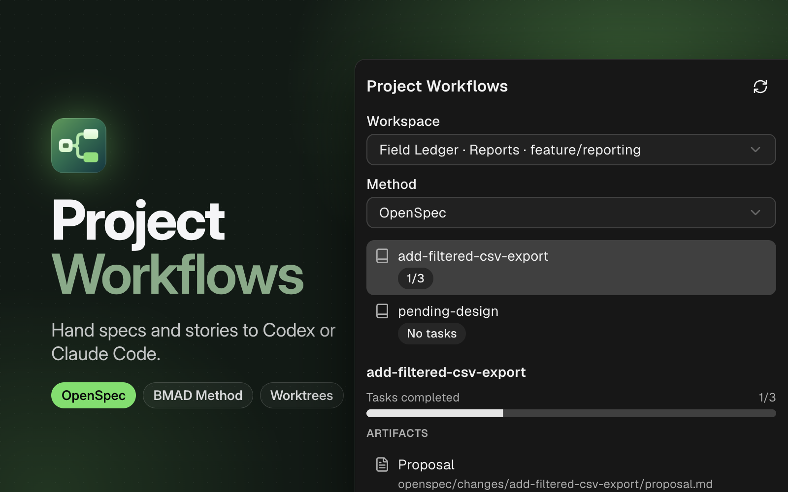
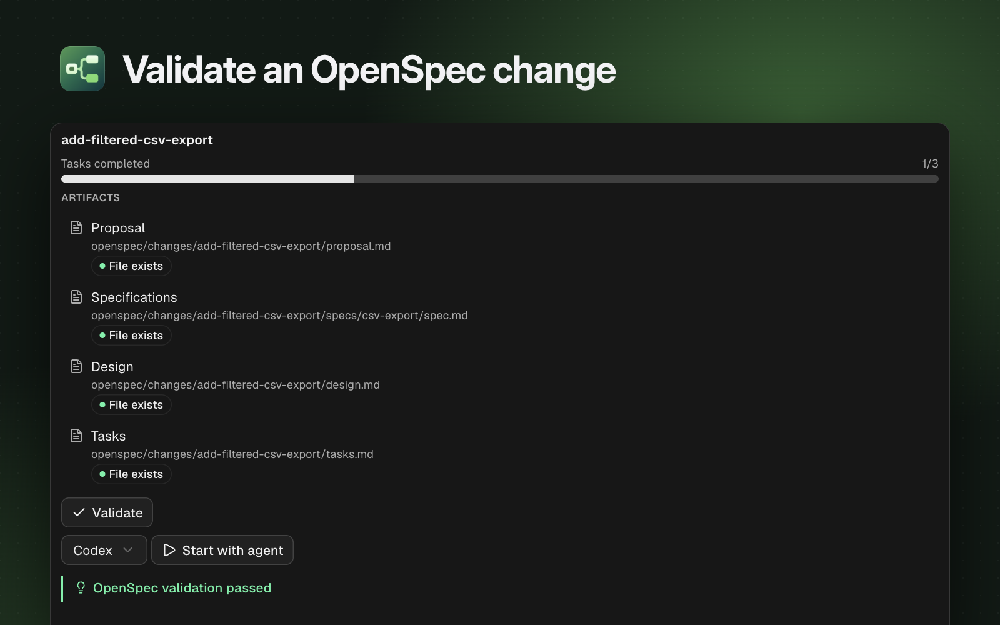
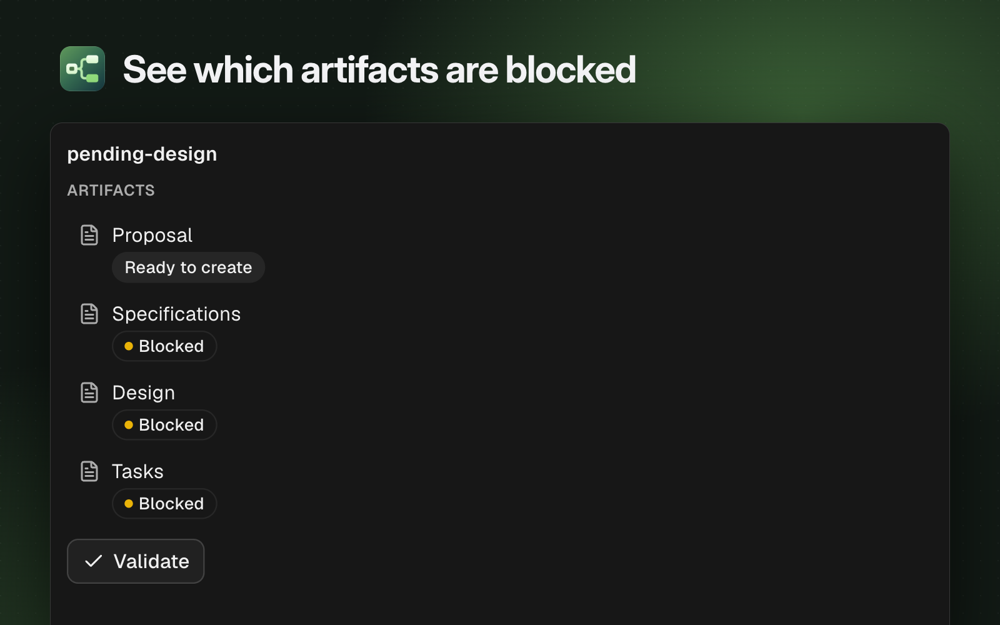
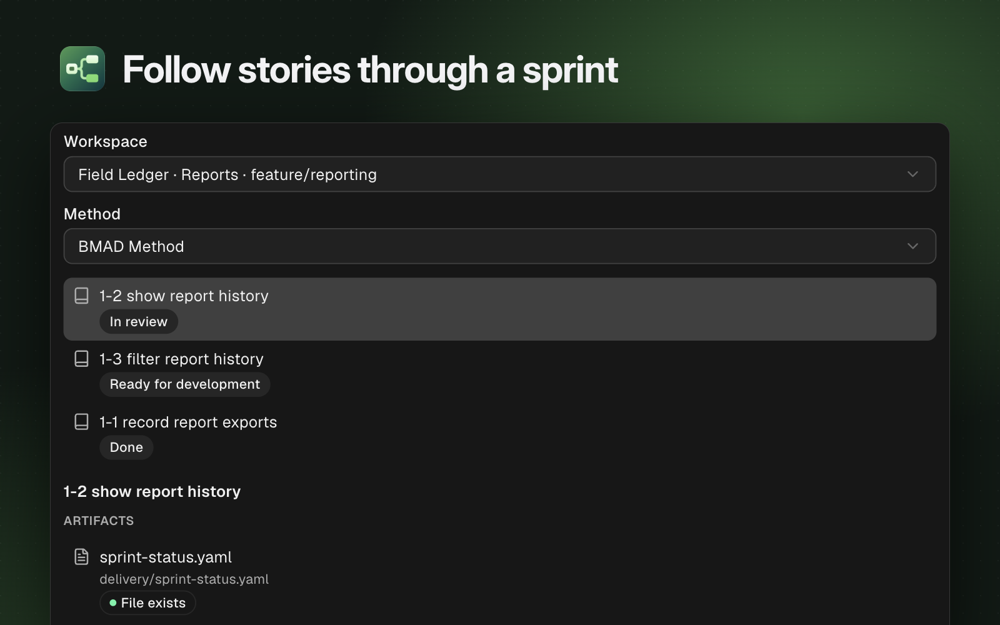
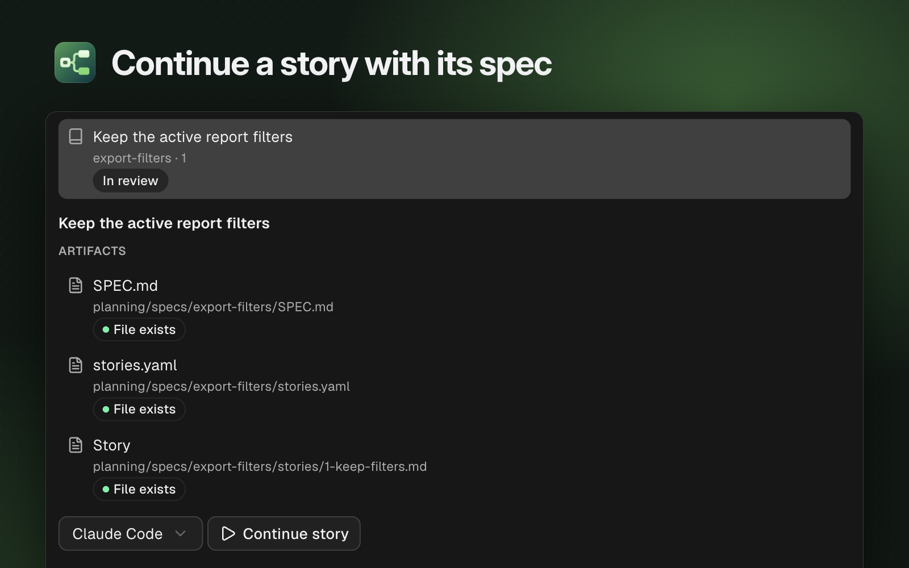
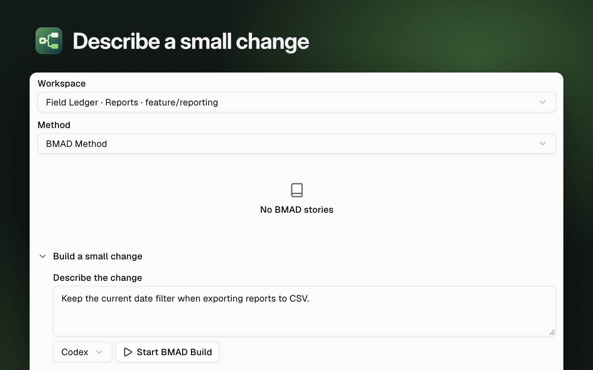

#  Project Workflows for Orca



Open an OpenSpec change or a BMAD story in Orca’s right sidebar. Read its planning files, check its progress and start Codex or Claude Code in the worktree that owns it.

## Install

Install the release from GitHub with Orca 1.4.248 or later.

```sh
orca plugin install Sergei-Popov/orca-project-workflows@v0.1.0 --json
```

Orca shows the publisher, repository and requested access before installation. Review them and use the approval command it prints. Open **Project Workflows** in the right sidebar. The panel selects the focused local workspace when it can identify it. Otherwise, choose a **Workspace**, then choose a **Method**. The interface follows Orca’s English or Russian locale.

## OpenSpec

Select a change under `openspec/changes/` to see its task counts and open a proposal, design, specification delta or task file. **Validate** runs OpenSpec’s structural checks and displays the findings. **Start with agent** passes the change ID and local artifact paths to your chosen agent. It asks for implementation when tasks remain and verification when all tracked tasks are complete.

The plugin looks for an executable named `openspec` on Orca’s PATH, outside the selected workspace. The CLI supplies the schema, artifact paths and apply state. Without it, the panel reads the standard local layout and can prepare a handoff from the proposal and task file. Custom schemas and validation require the CLI. On Windows a standalone `openspec.exe` enables CLI mode. When only a shell shim is installed, the local file view remains available.

<details>
<summary>View OpenSpec validation and blocked artifacts</summary>





</details>

## BMAD Method

The plugin supports the BMM module of BMAD Method 6.12.4. It resolves output, planning and implementation folders from the installation’s four TOML configuration layers.

| Source | What the panel shows |
| --- | --- |
| `stories.yaml` beside `SPEC.md` | Stories in spec order, the parent specification and each story’s implementation record when present. The record supplies its status. |
| `sprint-status.yaml` | Sprint stories and their recorded states, with the related epic and story files when available. |

**Continue story** passes the selected story, its files and any spec review checkpoint to the installed `bmad-build` skill. **Build a small change** starts the same skill from a written request. The agent menu offers the project’s installed Codex or Claude Code Build skills. Both handoffs ask the agent to present the implementation and checks for review before committing.

<details>
<summary>View sprint tracking, a story handoff and a small build</summary>







</details>

## Workspace access

The plugin runs a trusted Node.js worker under your account. It reads workflow files from the selected local workspace, executes the OpenSpec CLI there and parses BMAD configuration and artifacts locally. Orca grants `workspace:read` to identify workspaces, `workspace:write` to open files in the editor and `agent:launch` to start the chosen agent.

## Develop and test

```sh
orca plugin types . --json
npx -y -p typescript@5.9.3 -p @types/node@22.20.5 -- sh -c '
  types_dir=$(dirname "$(dirname "$(command -v tsc)")")/@types
  tsc -p . --typeRoots "./.orca/types,$types_dir"
'
orca plugin test . --json
orca plugin check . --json
orca plugin validate . --json
orca plugin inspect . --json
```

Use `orca plugin dev watch . --check --json` for local development. Release verification used the real OpenSpec 2.1.0 CLI and a BMAD 6.12.4 installation in linked Git worktrees. The tests exercised file discovery, validation and handoff construction. Orca’s SDK mock host recorded editor and agent requests with the selected workspace, file paths and prompts. The screenshots use the native components panel with fictional project data.

In a plugin hub checkout, run `../../scripts/listing-image.sh "$PWD" --dry-run --check --sheet` to rebuild the gallery previews. [Listing configuration](tools/listing.json) · [Editable icon](images/icon.svg)

The plugin is distributed under the [MIT License](LICENSE).
